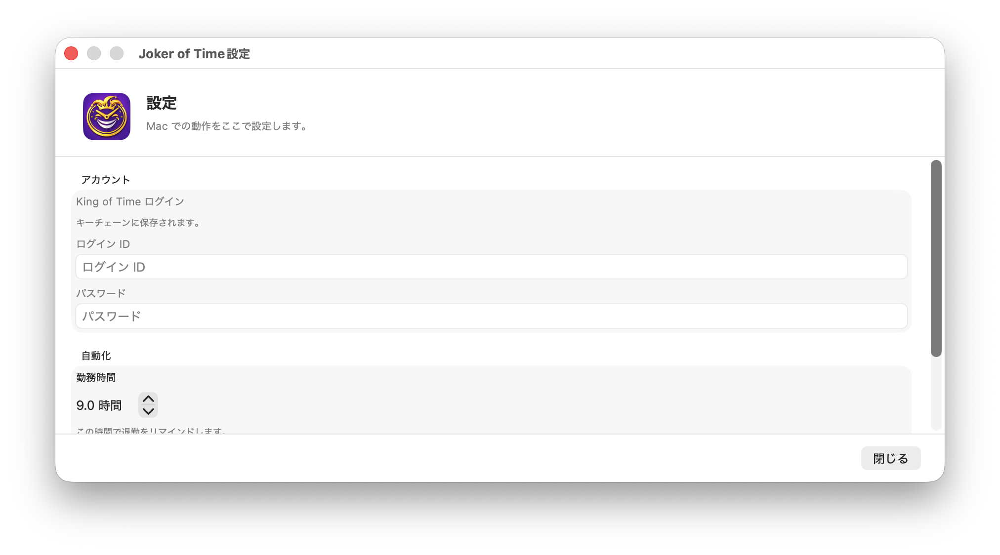
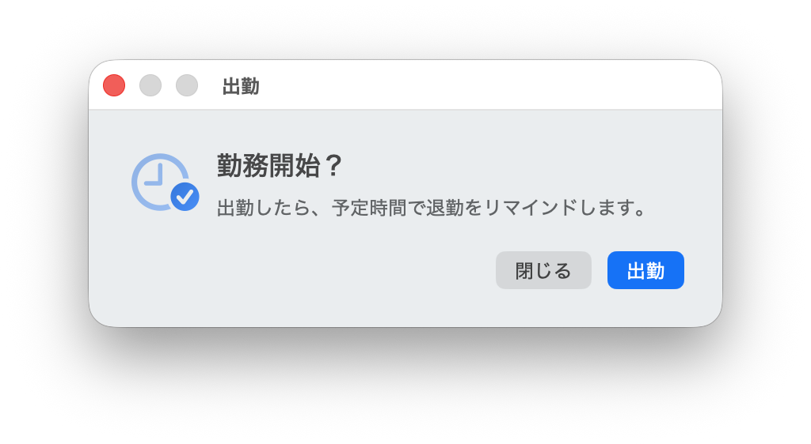
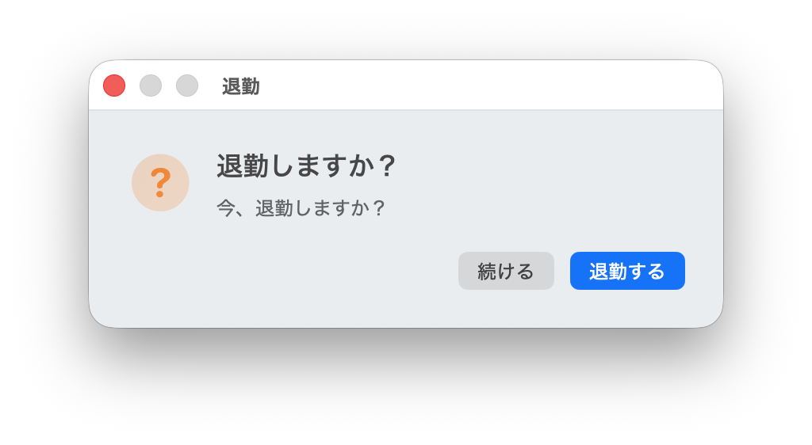
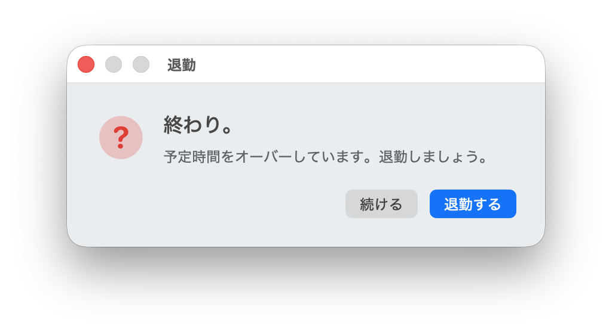
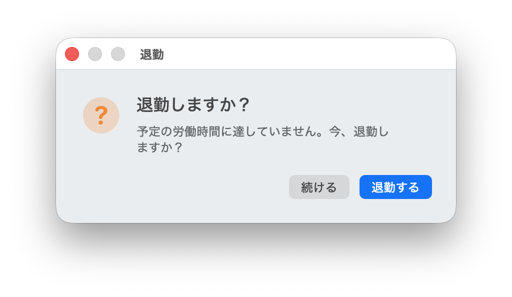

## 言語

- [English](README.md)
- 日本語（このページ）

  

# Joker of Time

タイムカードのボタンを、あなたの代わりにクリックしてくれる小さなメニューバーアプリです。

**King of Time** のWeb打刻システム専用に作られています。

---

## なぜ作ったのか

Webベースのタイムカードに出勤・退勤を打刻する作業は、

1. とても単純で
2. 完全に自動化できて
3. それなのに地味に面倒で忘れがち

…という、なんとも微妙な作業です。

ブラウザを開いて  
ブックマークを探して  
ログインして  
ボタンを押す  

これを毎日、朝と夜に。何年も。

難しいわけではありません。ただ、**退屈**なんです。  
多くのタイムカードシステムは、人が使いやすいようにというより、何かを証明するために作られたような操作感です。

だから忘れる。  
あとで思い出す。  
「あと5分だけ」と言いながら、気づけば大幅にオーバーしている。

**Joker of Time** は、その一連の流れを丸ごと無くすためのアプリです。

システムが王様を名乗るなら、こちらはトランプのジョーカーです。

メニューバーに静かに常駐し、  
ワンクリックで出勤・退勤。  
ブラウザもログイン画面も不要です。

そして、設定した勤務時間に達すると、  
「そろそろ終わってもいいのでは？」と、静かに知らせてくれます。

---

### ちょっとした計算（こういうのが好きな人向け）

打刻にかかる時間を**30秒**と仮定します。

- ブラウザを開く
- ページを探す
- ログイン
- ボタンを押す

これを1日2回。  
つまり**1日1分**です。

積み重ねると：

- 年間260営業日 → **約4時間20分**
- 5年 → **22時間**（ほぼ1週間分の労働時間）
- 10年 → **43時間**

つまり、**丸々1週間分の労働時間を、ただボタンを押すために使う**ことになります。  
何かを作るわけでもなく、ただクリックするだけ。

このアプリを入れれば、その1週間は別のことに使えます。

---

### できること

- ✅ 人事システムを満足させる
- ✅ うっかり残業の防止
- ✅ 無駄なブラウザタブを1つ減らす
- ✅ 「そろそろ帰ろう」を思い出させる
- ✅ 実態に近いタイムカードにする
- ✅ 「打刻修正お願いします」Slack DMの削減

---

*Joker of Time は King of Time や Human Technologies とは無関係の非公式ツールです。  
ブラウザと同じWeb画面を自動操作して打刻を行います。*

*使用は自己責任で行ってください。  
必ず会社の公式システム上の打刻を確認してください。*

*King of Time の[利用規約](https://www.kingoftime.jp/kot_contract/)や、  
会社のポリシーによっては自動化ツールの使用が制限されている場合があります。  
使用前に確認してください。無保証です。*

---

## インストール

- **macOS Tahoe** と **Node.js 24.11.0** で動作確認済み
- 自動化ヘルパーの実行に Node が必要です
- 他のOSやNodeバージョンでも動く可能性はありますが未検証です

[Releases](https://github.com/randym/joker-of-time/releases) から **DMG** をダウンロードし、

1. ダウンロード
2. 開く
3. Applications フォルダへドラッグ

これで完了です。

- DMGは **macOSでノータライズ済み**
- 初回起動時は、**Settings** が自動的に開き、King of Time の認証情報を入力できます
- デフォルトで **ログイン時に自動起動** します

もしここで壊れる場合は、たぶん何か冒険的なことをしています。  
まずは普通の手順で試してみてください。

---

## メニューバーアイコン

メニューバーのアイコンは次の状態を表示します。

| 状態 | アイコン | 意味 |
|------|----------|------|
| **待機中** | <picture><source media="(prefers-color-scheme: dark)" srcset="docs/icons/idle_clocked_out_unknown_dark.png"></picture> | 未出勤。打刻可能な状態 |
| **勤務中** | <picture><source media="(prefers-color-scheme: dark)" srcset="docs/icons/working_clocked_in_dark.png"></picture> | 出勤中 |
| **同期中** | <picture><source media="(prefers-color-scheme: dark)" srcset="docs/icons/syncing_fetching_timecard_dark.png"></picture> | 自動処理中 |
| **利用不可（ネットワーク切断）** | <picture><source media="(prefers-color-scheme: dark)" srcset="docs/icons/not_ready_network_offline_dark.png"></picture> | Mac がオフラインのため、自動処理を実行しません |
| **利用不可（Keychain エラー）** | <picture><source media="(prefers-color-scheme: dark)" srcset="docs/icons/not_ready_keychain_error_dark.png"></picture> | Keychain の問題で認証情報を読み書きできません |
| **利用不可（サイトに接続できない）** | <picture><source media="(prefers-color-scheme: dark)" srcset="docs/icons/not_ready_cannot_reach_site_dark.png"></picture> | この Mac から King of Time のサイトに接続できません |
| **利用不可（その他）** | <picture><source media="(prefers-color-scheme: dark)" srcset="docs/icons/not_ready_other_dark.png"></picture> | ヘルパー未検出などの事前チェック失敗。詳細はアラートを参照してください |

正常に動いていれば、このアプリの存在を忘れるはずです。  
それが理想の状態です。

---

## メニューと同期

Joker of Time はメニューバーに常駐し、基本的には静かにしています。

メニューからできること：

- **出勤 / 退勤**  
  ワンクリック。ブラウザ不要。
- **タイムカード同期**  
  他の場所で打刻した場合の更新
- **Settings**  
  認証情報、勤務時間、ログイン時起動
- **About**  
  バージョンや状態の確認

特別なことはありません。必要なものだけです。

---

## 設定

### King of Time 認証情報

初回起動時（または未設定の場合）、**Settings** が自動的に開き、認証情報を入力できます。

以下を入力してください：

- ログインID
- パスワード

King of Time の打刻サイトと同じものです。

認証情報はこのMacの **macOS Keychain** にのみ保存され、  
打刻と同期のためだけに使用されます。

もし仕様が変わることがあれば、このREADMEで大きく告知します。

設定はいつでも変更できます。

---

## Settings

### Credentials

認証情報を変更できます。

### 勤務時間

1日の勤務時間を設定します。

例：

- 合計9時間
- 実働8時間
- 休憩1時間

この時間に達すると、退勤のリマインドが表示されます。

### General

デフォルトでログイン時に自動起動します。  
毎朝起動する必要はありません。

また、スリープ復帰時に自動同期を行います。  
長い間再起動していないMacでも安心です。

---

## プロンプト

### 「出勤しますか？」（出勤）

勤務日に未出勤の状態だと、  
「出勤しますか？」ダイアログが表示されます。

- **Yes** でそのまま出勤
- 「今日は表示しない」も選択可能

ブラウザもログインも不要です。

---

### 「そろそろ終わりますか？」（退勤）

#### 定時到達時

設定した勤務時間に達すると、  
「退勤しますか？」ダイアログが表示されます。

予定通り働いたので、  
そろそろ終わってもいい時間です。

ワンクリックで退勤できます。

---

#### 残業中

そのまま働き続けると、  
どれくらいオーバーしているか表示されます。

15分ごとにリマインドが表示されます。

しつこくはありません。  
ただ、帰りたい同僚のように、静かに促してきます。

---

#### 早めに退勤する場合

勤務時間に達する前に退勤すると、  
残り時間が表示されます。

そのまま退勤しても問題ありません。  
説教も罪悪感もありません。ただの情報です。

退勤後は、その日の勤務は終了扱いとなり、  
再度出勤を促すことはありません。

---

もしこのアプリのおかげで、

- 打刻修正が1回減ったり
- 「なんでまだ会社にいるんだろう」と思う夜が1回減ったり

したなら、それで十分役目を果たしています。

中身が気になる人はソースコードをどうぞ。  
普通に打刻して定時で帰りたい人は、DMGだけで十分です。
