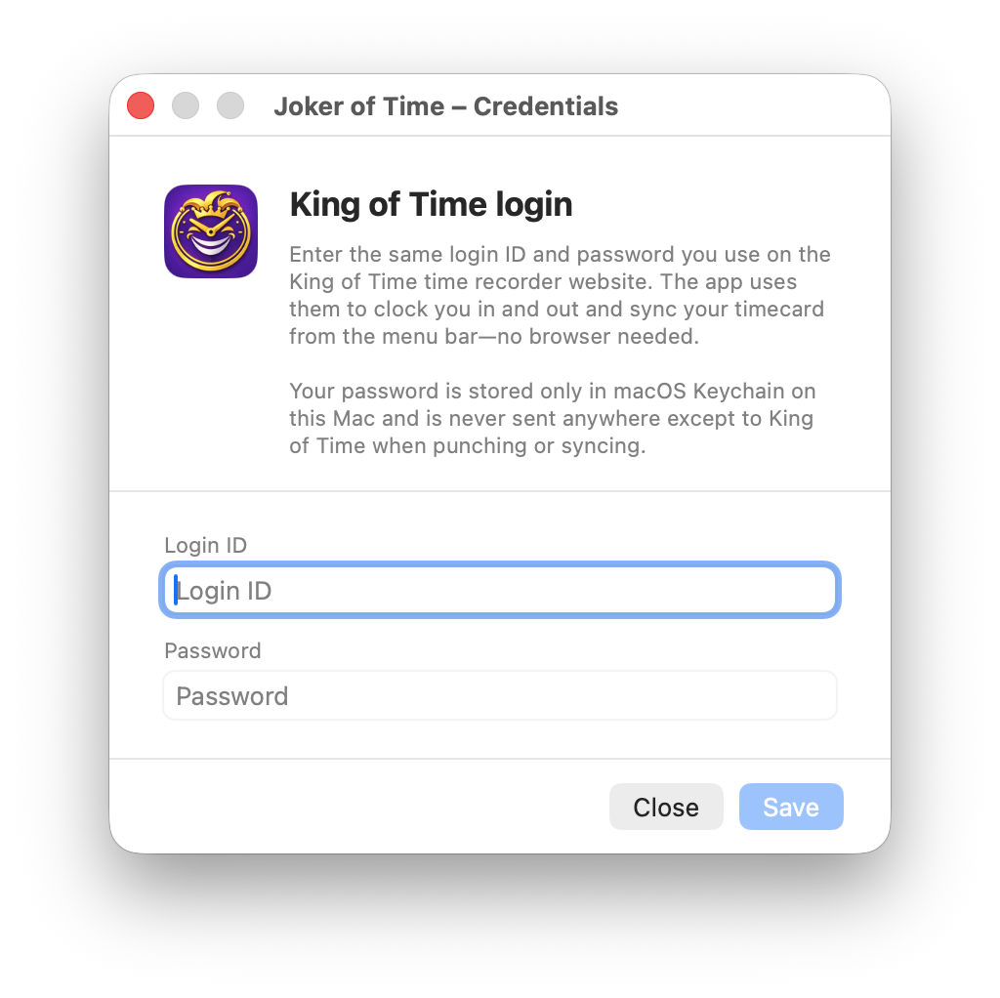
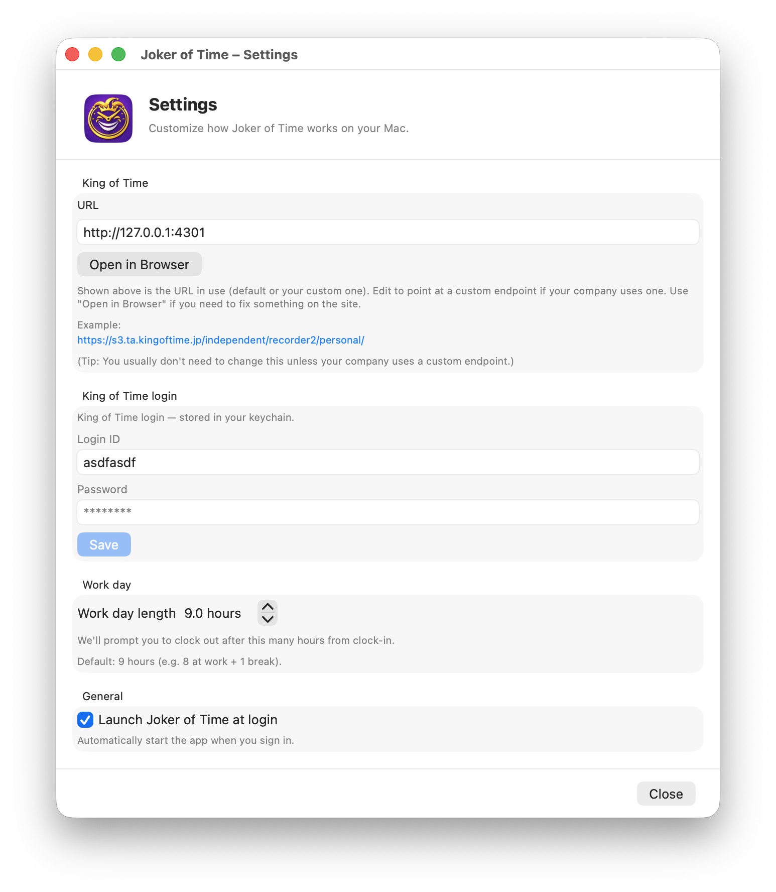
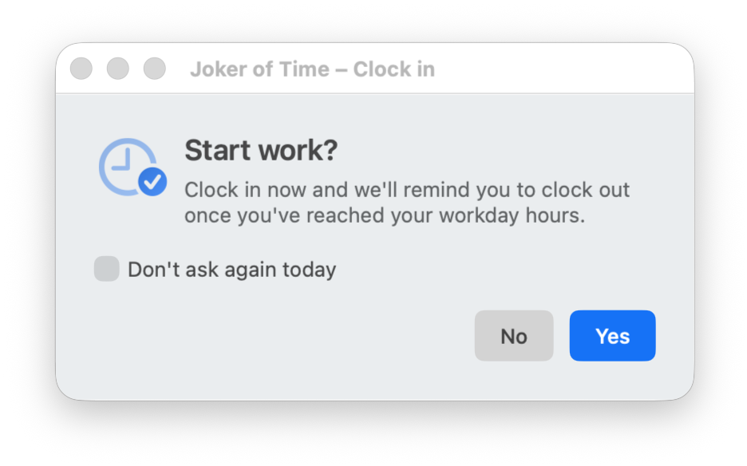
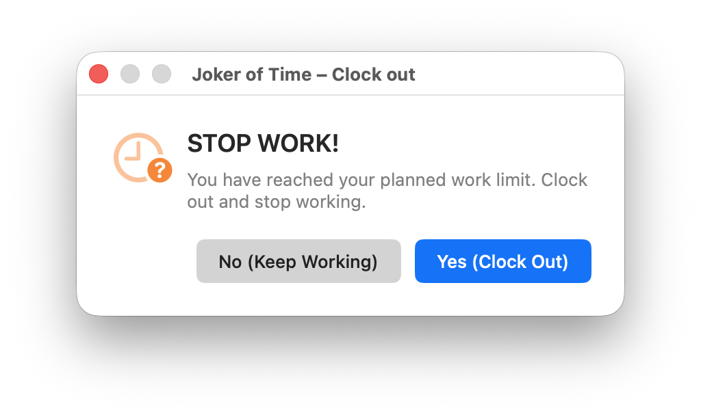
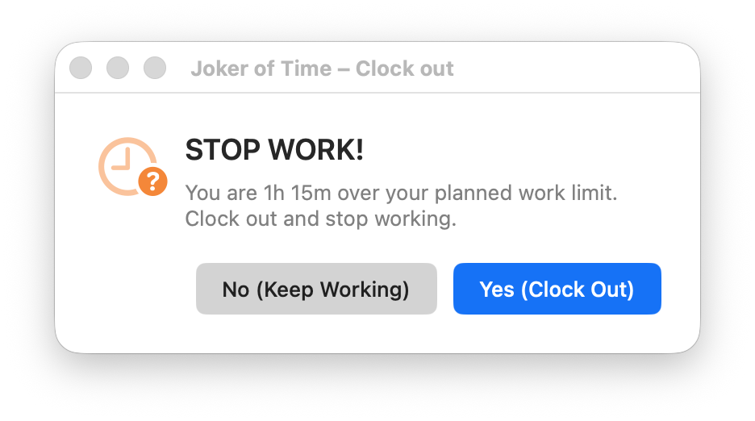
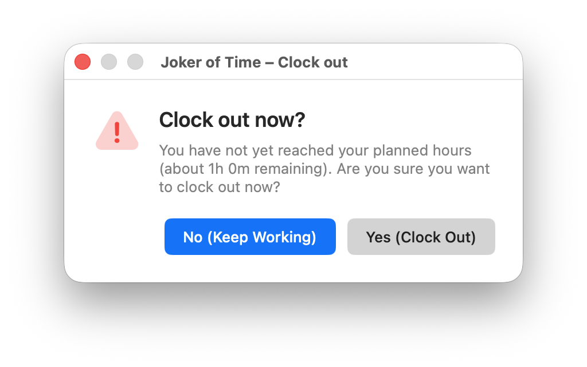

## 言語

- [日本語](README.ja.md)
- English (this page)

  

# Joker of Time

A tiny menu bar app that clicks the timecard button so you don’t have to.

Built specifically for the **King of Time** web timecard system.

---

## Why this exists

Clocking in and out of a web-based timecard system is one of those tasks that is:

1. Extremely simple
2. Completely automatable
3. Somehow still annoying enough to forget

You open a browser.  
You find the bookmark.  
You log in.  
You click a button.  

Twice a day. Every day. For years.

If you’re anything like me, it’s not the difficulty that gets you—it’s the sheer boredom of the task. Most timecard systems feel like they were designed to prove a point, not to be used by humans. So you forget. Or you remember late. Or you stay clocked in long after you meant to leave because you were “just finishing one thing.”

**Joker of Time** exists to remove that entire sequence from your life.

If the system insists on being the king, this is the joker in the deck.

It sits quietly in your menu bar.  
One click clocks you in or out.  
No browser. No login page. No wandering tabs.  

And when you’ve worked your planned hours, it politely suggests that maybe—just maybe—you should stop.

---

### The math (for anyone who enjoys quiet existential dread)

Let’s say it takes **30 seconds** to:

- open the browser
- find the page
- log in
- click the button

You do that **twice a day**. That’s **1 minute per workday**.

Over time:

- 260 workdays → **4⅓ hours per year**
- 5 years → **22 hours** (almost a full workweek)
- 10 years → **43 hours**

That’s a full workweek of your life spent clicking a button. Not building anything—just clicking.

You could also just install this app and spend that week doing literally anything else.

---

### What it does for you

- ✅ Keeps your HR system happy
- ✅ Helps prevent accidental overtime
- ✅ Removes one more pointless browser tab
- ✅ Encourages you to actually stop working
- ✅ Keeps your timesheet closer to reality
- ✅ Reduces “please correct your timecard” Slack DMs

---

*Joker of Time is not affiliated with King of Time or Human Technologies.  
It’s an unofficial helper that automates punching via the same web interface you’d use in a browser.*

*Use it at your own risk. Always verify your times in your company’s official system.  
King of Time’s [terms of use](https://www.kingoftime.jp/kot_contract/) (and your employer’s policy) may restrict automated access. Make sure you’re allowed to use tools like this. No warranty.*

---

## Installation

- Built and tested on **macOS Tahoe** with **Node.js 24.11.0**
- Node is required; the app uses it to run the automation helper
- Other OS or Node versions may work, but haven’t been tested

Install from the **DMG** in  
[Releases](https://github.com/randym/joker-of-time/releases):

1. Download
2. Open
3. Drag to Applications

That’s it.

- The DMG is **notarized** for macOS
- On first launch you’ll be asked for your King of Time credentials
- The app is set to **launch at login** by default

If you manage to break this during installation, you were probably trying something adventurous. Try the default steps first.

---

## Menu bar icon

The menu bar icon shows these states:

| State | Icon | Meaning |
|-------|------|---------|
| **Idle** | <picture><source media="(prefers-color-scheme: dark)" srcset="docs/icons/idle_clocked_out_unknown_dark.png"></picture> | Not clocked in; ready to clock in or sync |
| **Working** | <picture><source media="(prefers-color-scheme: dark)" srcset="docs/icons/working_clocked_in_dark.png"></picture> | Clocked in; you’re on the clock |
| **Syncing** | <picture><source media="(prefers-color-scheme: dark)" srcset="docs/icons/syncing_fetching_timecard_dark.png"></picture> | Automation running |
| **Not ready — network offline** | <picture><source media="(prefers-color-scheme: dark)" srcset="docs/icons/not_ready_network_offline_dark.png"></picture> | Mac is offline; app won’t run automation until network is back |
| **Not ready — keychain error** | <picture><source media="(prefers-color-scheme: dark)" srcset="docs/icons/not_ready_keychain_error_dark.png"></picture> | Keychain problem; credentials can’t be loaded or saved |
| **Not ready — cannot reach site** | <picture><source media="(prefers-color-scheme: dark)" srcset="docs/icons/not_ready_cannot_reach_site_dark.png"></picture> | King of Time site can’t be reached from this Mac |
| **Not ready — other** | <picture><source media="(prefers-color-scheme: dark)" srcset="docs/icons/not_ready_other_dark.png"></picture> | Helper not found or other preflight failure; see alert for details |

If everything is working properly, you’ll forget this app exists—which is exactly the point.

---

## Menu and Sync

Joker of Time lives in your menu bar and mostly keeps quiet.

From the menu you can:

- **Clock in** / **Clock out**  
  One click. No browser.
- **Sync Timecard**  
  Refresh from King of Time if you punched elsewhere.
- **Settings**  
  Credentials, work hours, URL, launch at login.
- **About**  
  Version, status, and Node version.

Nothing fancy. Just the things you actually need.

---

## Configuration

### King of Time credentials

On first run (or if none are saved), a credentials window appears.

Enter the same:

- **Login ID**
- **Password**

that you use on the King of Time time recorder site.

Your credentials are stored only in the **macOS Keychain** on this Mac.  
They are used solely to punch and sync with King of Time.

If this ever changes, it will be very loudly documented here.

You can update them anytime from **Settings**.

---

## Settings

### King of Time URL

If your company uses a custom King of Time endpoint, you can set it here.  
Most users should leave the default alone.

### Credentials

Update your login information whenever needed.

### Work day duration

Set the number of hours you work per day.

Example:

- 9 hours total
- 8 hours work
- 1 hour break

The app uses this to know when you’ve reached your planned time and will gently remind you to clock out.

### General

By default, the app launches at login.  
No remembering required.

It also syncs automatically when your Mac wakes from sleep.  
Useful if, like many developers, you haven’t restarted in a suspiciously long time.

---

## Prompts

### “Start work?” (clock in)

On a working day, when you’re not clocked in yet, the app may show a **“Start work?”** dialog.

You can:

- Click **Yes** to clock in immediately
- Choose **Don’t ask again today**

No browser. No login. No wandering into email and losing 20 minutes.

You can also clock in anytime from the menu.

---

### “Ready to stop?” (clock out)

#### End of shift (automatic)

Once you’ve worked your configured hours, the app shows a **“STOP WORK!”** dialog.

You planned your hours.  
You worked your hours.  
Now you can stop.

One click clocks you out.

---

#### Over planned hours

If you keep working, the dialog shows how far over you are.

The app will remind you every 15 minutes until you clock out.

Not aggressively. Just persistently. Like a polite coworker who wants to go home.

---

#### Leaving early (from the menu)

If you clock out before your planned hours, the app shows how much time is left.

You can still clock out if you want.  
No lectures. No guilt. Just information.

After clocking out, the app considers your day finished and won’t prompt you again.

---

If this saves you even one correction request or one late-night  
“why am I still here” moment, it’s doing its job.

If you’re curious about the internals, the source is here.  
If you’re just here to clock in and go home on time, the DMG is all you need.
